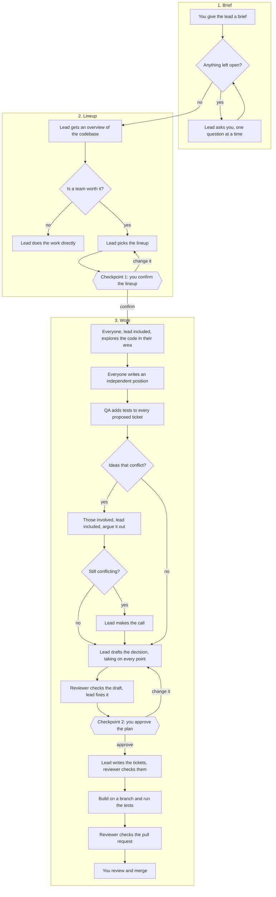

# engineering-team

A [Claude Code](https://docs.claude.com/en/docs/claude-code) skill that runs your software planning like an engineering team.

You bring a brief, such as *"add magic-link login"* or *"move reporting off the main database"*. A **team lead** takes it on. It asks you only what the brief leaves open, looks over your codebase, and picks the right lineup of specialists for the job. You confirm the lineup before anyone starts.

Then the team gets to work, like a real engineering team in a planning session. Everyone, the lead included, digs into the code in their own area and brings their view, and they argue it out. Where the team agrees, that's the plan. Where ideas still conflict, the lead makes the call. An independent reviewer checks the result, and nothing is built until you approve the plan.

What you get back is a decision you can act on: the scope, the approach, what was rejected and why, acceptance criteria, a test plan, the risks being accepted, and tickets ready to build from.

## How it works



There are three phases, and the lead runs all of them:

1. **Brief.** The lead makes sure it understands what you want.
2. **Lineup.** The lead decides who is needed, and you confirm it.
3. **Work.** The team, lead included, explores the code and debates. The lead settles what's still in conflict, you approve, and it's built.

## The problem it solves

Ask an assistant to plan a feature and you get one confident answer. It usually runs with however you framed the request, and it rarely pushes back. The gaps show up later, when they cost more to fix:

- **Blind spots surface during the build.** The migration that can't be rolled back, the permission check nobody thought of, the edge case with no test. A real team catches these in planning, because someone in the room is paid to worry about each one.
- **Plans overbuild.** A single planner tends to add layers, abstractions and dependencies "for later", when reusing what's already in the codebase would have done.
- **Nobody argues.** One viewpoint means no one asks "what if we didn't?" or "what breaks if this is slow?", so weak assumptions go unchallenged.
- **Decisions vanish.** The reasoning lives in a chat history. A week later, nobody remembers why an approach was chosen or what was ruled out.
- **You either micromanage or rubber-stamp.** You review every step yourself, or you approve a plan you haven't really checked.

This skill brings back what a good team does in a planning session: a lead who picks the right people and works alongside them, a short, structured disagreement grounded in the real code, one person accountable for the final call, an independent review, and a written record that becomes the tickets.

## Requirements

- **[Claude Code](https://docs.claude.com/en/docs/claude-code).** That's all it needs.
- **[GitHub CLI](https://cli.github.com/)** (`gh`), signed in, if you want tickets created as GitHub issues and pull requests opened. Without it, the plan and tickets stay in the conversation.

### Recommended

Both are optional, but worth having in the projects where you use this skill:

- **[Graphify](https://pypi.org/project/graphifyy/)** (`pip install graphifyy`) builds a map of the repository, so the lead starts from how the code really fits together. Without it, the lead reads the code directly.
- **[Ponytail](https://github.com/DietrichGebert/ponytail)** pushes plans and code towards the smallest thing that works. Without it, the team still follows the same reuse-first rules, which are built into the skill.

## Install

Clone it into your Claude Code skills folder:

```sh
git clone https://github.com/SamNewhouse/engineering-team ~/.claude/skills/engineering-team
```

Restart Claude Code. `engineering-team` will appear in the skills list.

To update it later:

```sh
git -C ~/.claude/skills/engineering-team pull
```

## Usage

Open Claude Code in your project and hand the lead a brief:

```
/engineering-team Add CSV export to the orders page, keeping the current filters
```

You can also just describe the work. The skill picks up planning and design work that spans several areas or carries real risk.

**When it's worth using:** a feature that touches several parts of the system, anything involving payments, personal data, permissions or migrations, or a change with more than one sensible approach.

**When it isn't:** a one-file fix, a clear bug or a small edit. The lead notices this, says so, and just does the work.

## Each phase in detail

### Phase 1: Brief

The lead reads your brief and checks it has what it needs: the goal, any constraints, and what "done" means. If something is missing, it asks you, one question at a time. If the brief already covers it, it doesn't ask.

### Phase 2: Lineup

**The lead gets an overview of the codebase.** Just enough to see which areas the change touches (modules, services, data, APIs, shared components, tests, deployment), and so who it needs on the team. It notes the exact files and line ranges it finds, to hand out later. It uses Graphify if you have it, and searches the code if not. The detailed digging is the team's job.

**The lead decides whether a team is worth it.** If the job turns out to be small with one obvious approach, it says so and does the work itself.

**The lead picks the lineup.** This is the lead's call. It decides which specialists it needs, how many of each and at what level, and adds QA (and a reviewer for bigger teams).

**Checkpoint 1: you confirm the lineup.** You see the team size, and each role and its levels. Confirm it, or ask for changes. Nothing runs until you say yes.

### Phase 3: Work

**Everyone explores the code.** Each member, the lead included, digs into the parts of the codebase its role covers: security traces the auth flow, data checks what reads the table, frontend finds the components to reuse. Each starts from a map the lead hands over: the exact files and line ranges for its area. They read those lines first, and query Graphify or search only for what the map doesn't cover. Nobody changes anything yet.

**Independent positions.** Everyone works alone, in parallel, and writes a recommendation, the reasoning, risks, assumptions, what would change their mind, any questions, and the tickets they'd create. Every claim about existing code points to the file and line it comes from. The lead writes its own position before reading anyone else's, so it doesn't steer the others. If someone can't answer a question from the code, the lead finds out or asks you. Nobody guesses.

**QA pass.** QA adds acceptance criteria and tests to every proposed ticket.

**Disagreements.** Where ideas conflict on something that matters, those involved, the lead included, see each other's positions word for word and argue it out. At most four debate at a time, and there's only one such round.

**The lead drafts the decision.** Where the team agrees, that's the decision. Where ideas still conflict, the lead makes the call, weighing the arguments rather than counting votes, and records why. The lead takes on every point raised, including ones it argued against. Every point gets exactly one outcome: **adopted**, **rejected** (with a reason), **risk accepted** (with a reason) or **open question**.

**The reviewer checks the draft.** The reviewer hasn't taken part in the debate, so it has no position to defend. It looks for gaps, contradictions, overbuilding and points left without an outcome. The lead makes the fixes. If a fix reopens a specialist's area, the lead asks that specialist directly.

**Checkpoint 2: you approve the plan.** You see the final scope and approach, the rejected alternatives, the acceptance criteria, the test plan, the risks accepted, the open questions, any point where the reviewer and the lead still disagree, and the list of tickets it will create. Approve it, or push back. Your yes also covers creating those tickets.

**Tickets.** The lead writes each ticket in full: the problem, the plan, which files to change, acceptance criteria and tests, and what it depends on. The reviewer checks that nothing from the decision was lost, then the tickets are posted as GitHub issues. Open questions become tickets of their own. The debate itself never goes into a ticket, only the decision and its reasons.

**Build.** The work is built on a new branch and the project's tests are run. The reviewer checks the pull request against the acceptance criteria. You get the pull request link to review and merge.

## The lineup

### Sizes

| Size | For | Members |
|---|---|---:|
| **Lite** | Small, low-risk changes with one real design choice | 3 |
| **Medium** | Normal feature work | 4 to 7 |
| **Large** | Complex, high-risk or multi-area work | 8 to 11 |

Sizes don't count the lead, who is always on the team as well. The lead picks the size that fits the brief.

### Specialists

The lead chooses from these, based on the brief:

| Area | Specialists |
|---|---|
| Product and design | Product planner, UX planner |
| Building it | Systems architect, backend planner, frontend planner, data planner, integration planner |
| Running it safely | Security planner, DevOps planner, performance planner |
| After launch | Documentation planner, analytics planner |

A user-facing feature gets product, UX and frontend. A payments change gets security, data and architecture.

### Fixed roles

- **QA** is always in the lineup: one or two members, never junior. It owns the acceptance criteria and the test plan.
- **Reviewer** joins medium and large lineups. It doesn't debate. It checks the draft decision, the tickets and the code.

### Levels

| Level | Model | Brings |
|---|---|---|
| Senior | Sonnet, or Opus for high-risk calls | Architecture, security, long-term trade-offs |
| Mid-level | Sonnet | Practical planning and delivery |
| Junior | Haiku | Challenging assumptions, spotting simple gaps |

A role has one to three members. A junior is only ever the third member of a role, never on its own.

### Example lineups

| Brief | Size | Lineup |
|---|---|---|
| Simple UI change | Medium, 4 | UX, frontend, QA, reviewer (all mid-level) |
| New API endpoint with data changes | Medium, 6 | Product, architect, backend, data, QA, reviewer |
| Complex backend migration | Large, 8 | 2 architects, 2 backend, data, 2 QA, reviewer |
| Payments or personal data | Large, 8 | Product, architect, backend, data, security, 2 QA, reviewer |

## Nothing gets lost

- **Every point has an ID**, such as `SEC-S1` (security, senior, point 1), so you can follow it from the debate to a ticket.
- **Claims are backed by the code.** Anything said about existing code points to the file and line. Anything not checked is marked as unchecked.
- **No second-hand summaries.** When specialists respond to each other, they see the opposing positions word for word.
- **Short notes, full facts.** Specialists write terse structured notes to save tokens, but every field is filled in, and file paths and numbers are copied exactly.
- **Every point ends with an outcome.** The decision isn't finished until it does, and the reviewer checks this.
- **The reviewer only checks.** It reports what it finds, the lead makes the changes, and anything still disputed comes to you.

## Token use

A team run uses more tokens than a single conversation, and a bigger lineup uses more. To make a run cheaper, ask the lead for a smaller lineup at checkpoint 1.

The skill is built to keep token use down without losing anything:

- **The lead hands out exact file paths.** Each member gets the files and line ranges for its area, instead of searching the codebase from scratch.
- **Members read line ranges, not whole files**, and only search for what they weren't given.
- **Prompts share the same opening.** Every member's prompt starts with an identical shared part, so repeated text can be served from the prompt cache.
- **Members are continued, not restarted.** Follow-up rounds and the reviewer's checks pick up the same agents, so nothing is re-sent.
- **Only the disputed points go round again.** Members who disagree see just those points, not everyone's full write-up.
- **Notes, not essays.** Members report to the lead in short structured notes.
- **Juniors stay focused.** A junior only checks the assumptions it challenges.

## Customising

- **Roles** live in `roles/`, one short file each. Edit one to change its focus, or add a new role and list it in `SKILL.md`.
- **Team rules** (sizes, levels, the debate format, reviewer checks, tickets, token savings) live in `rules/team-composition.md`.

## Layout

```
engineering-team/
├── SKILL.md                   the workflow Claude Code follows
├── README.md
├── LICENSE
├── roles/                     one file per role
├── rules/team-composition.md  sizes, levels, debate, decision, reviewer, tickets
└── companions/
    ├── graphify.md            how the team uses Graphify (or reads the code without it)
    └── ponytail.md            the reuse-first rules
```

## Licence

[MIT](LICENSE)
